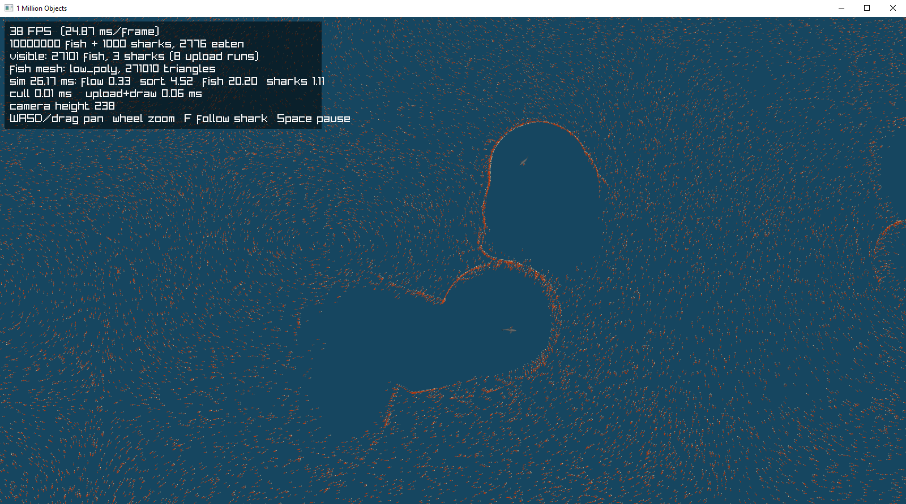

# 1MillionObjects
This is a challenge project to show I can render 1 million unique 3d objects

1,000 sharks chase 3,000,000 fish around a 2000 × 2000 ocean. Fish drift on swirling currents and flee any shark within 20 units. Sharks are faster, and an eaten fish respawns somewhere else, so the count stays constant.

### Update
I ended up getting to 10 million fish until fps starting dropping below 30 fps



## Running

Requires Zig 0.16.0. raylib-zig is pinned to the last commit that supports 0.16.

```sh
zig build run
```

The build defaults to ReleaseFast and targets your own CPU. Pass `-Doptimize=Debug` for a debug build, which runs at about 10 FPS. Pass `-Dcpu=baseline` for a binary that runs on other machines.

| Input | Action |
| --- | --- |
| WASD / arrows, or drag with the mouse | Pan |
| Mouse wheel, `+` / `-` | Zoom |
| `F` | Follow the nearest shark |
| `Space` | Pause |

Benchmark mode renders a fixed number of frames with vsync off, saves a screenshot and prints average timings:

```sh
zig-out/bin/1MillionObjects --shot out.png --height 2600 --frames 240 [--threads N] [--follow]
```

On a Ryzen 7 3700X, frames take about 10–13 ms when zoomed in and about 15 ms with all 3,001,000 objects on screen.

## How it works

- **Structs of arrays.** Each species is a set of `x`, `z` (f32) and `vx`, `vz`, `phase` (f16) arrays: `Bodies` in [src/sim.zig](src/sim.zig). A fish is 14 bytes.
- **Spatial grid via counting sort.** Every frame the fish are re-sorted into a 125 × 125 grid of 16-unit cells. The sort is parallel and stable: per-thread histograms, then a scatter into a second set of arrays. It keys on each fish's cell at the start of the frame, so the update and the scatter run as one pass: every fish is read once, updated, and written to its sorted slot. Each grid row is one contiguous range of memory, so shark prey searches and view culling read runs instead of chasing indices.
- **Threat lists.** Each frame, every shark is listed in each grid cell its flee circle touches. A fish only checks its own cell's list, which is empty for most fish.
- **Threads.** Per-entity work is split into one chunk per hardware thread (minus one for the main thread) and run on the `std.Io` thread pool. The next simulation step runs on a background thread while the main thread uploads and draws the current state. That's safe because the step only reads the current arrays and writes the other set.
- **Culling.** The camera frustum is projected onto the ground plane. Only the grid rows and column spans inside it reach the GPU, though every object is still simulated.
- **Upload.** The instance buffer has one section per field, matching the simulation's arrays. Visible fish are a few contiguous runs, so they are uploaded straight from the simulation's arrays with no CPU-side copy.
- **Draw calls.** One instanced draw for fish and one for sharks. The vertex shader works out the heading from the velocity and animates the swim wiggle. The fish model's three meshes are merged into one, and the fish switches level of detail by camera height: the 686-triangle model, then a 10-triangle low-poly fish above 100, then a single triangle above 700.

## Credits

3D models are not covered by this project's MIT license. They belong to their creators:

- `shark.glb`: [Poly by Google](https://poly.pizza/u/Poly%20by%20Google), licensed [CC BY 3.0](https://creativecommons.org/licenses/by/3.0/)
- `fish.glb`: [Quaternius](https://quaternius.com/), licensed [CC0 1.0](https://creativecommons.org/publicdomain/zero/1.0/)
